# Biyahe Companion

**A sensor-powered ride companion for Android.** Biyahe Companion uses the sensors in your phone to rate how comfortable a trip was, warn you about unsafe driving, and let you report road hazards like potholes and floods.

It works for both **drivers** and **passengers** (jeepney, bus, car). It was built with Metro Manila roads in mind.

<p align="center">
  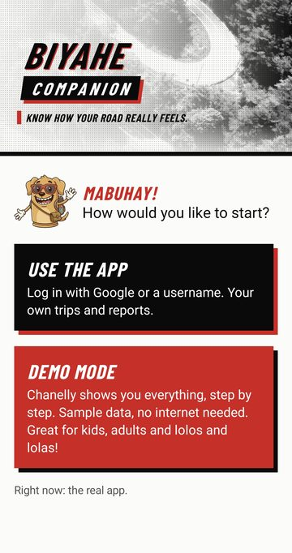
  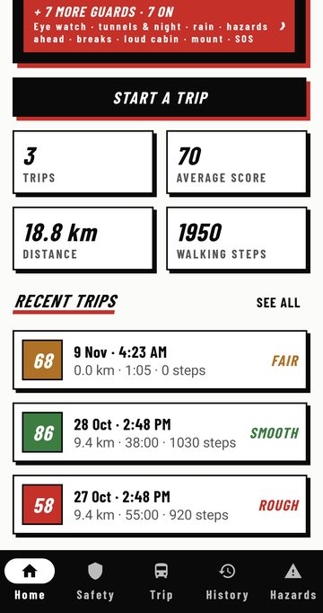
  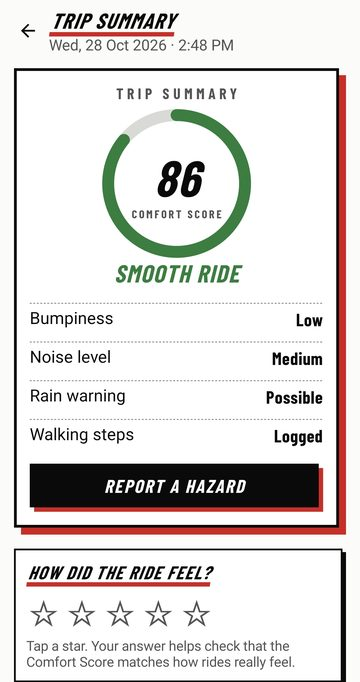
  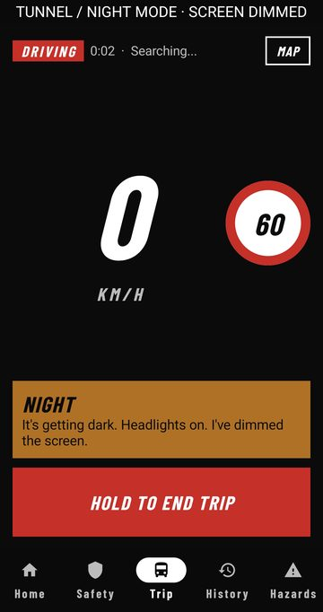
</p>

---

## Screenshots

### Trips & Comfort Score
<p>
  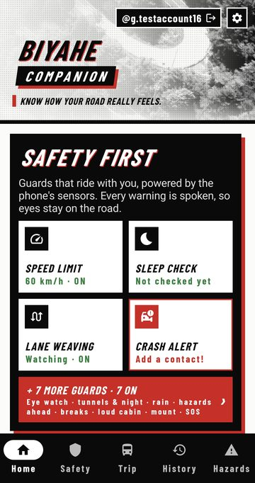
  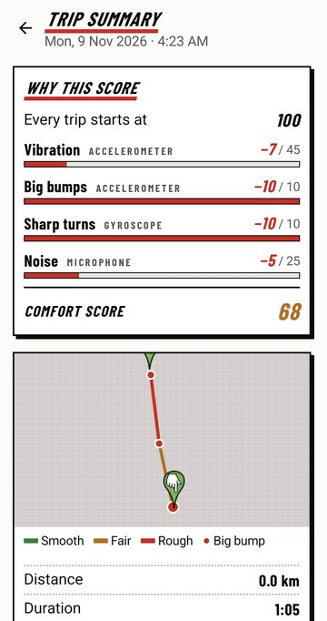
  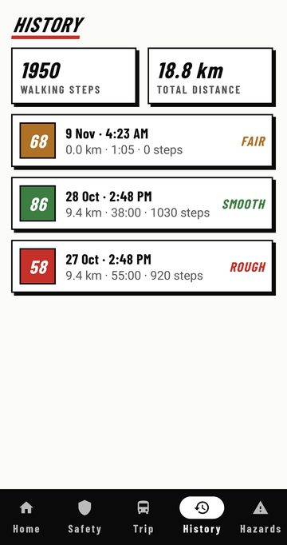
  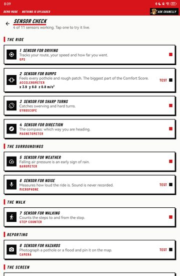
</p>

### Safety
<p>
  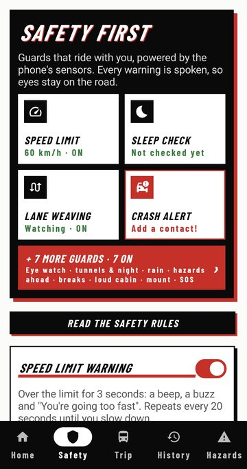
  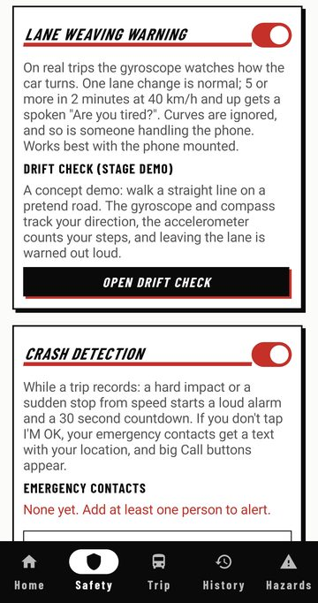
  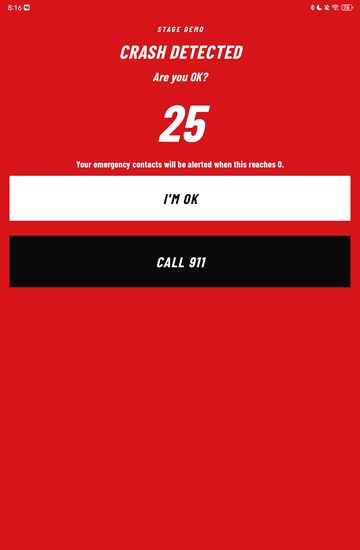
  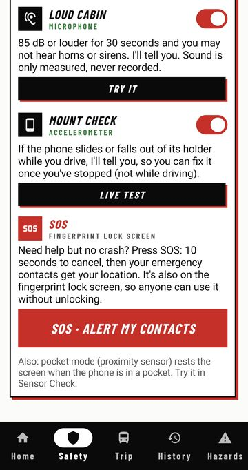
</p>

### Admin dashboard & demos
<p>
  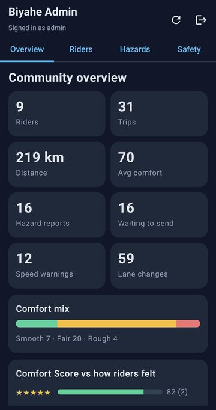
  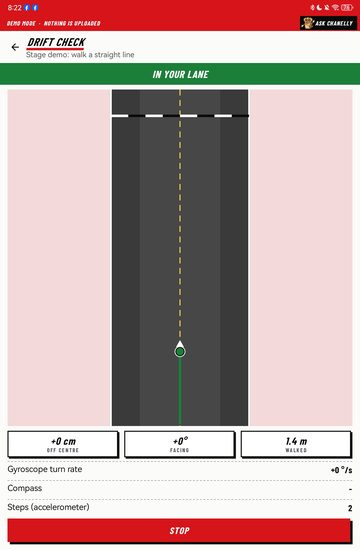
</p>

---

## Features

### 🚌 Trip tracking & Comfort Score
- Records your route, speed and distance with GPS and draws it on an OpenStreetMap map. No API key needed.
- Gives each trip a **Comfort Score (0–100)**, rated *Smooth*, *Fair* or *Rough*. The score is based on:
  - vibration and **bumps/potholes** (accelerometer)
  - **sharp turns and swerving** (gyroscope)
  - **cabin noise** (microphone; it measures loudness only, and sound is never recorded)
- Tags **Fast Run** trips: an average of 40 km/h or more on a smooth road.
- Counts **walking steps** to and from the stop.
- Shows a score breakdown and keeps a full trip history.

### 🛡️ Safety
- **Speed limit warning.** It ignores single bad GPS readings and doesn't nag when you hover right at the limit.
- **Lane-weaving detection.** It tells normal lane changes and curves apart from repeated weaving, and it is checked against the GPS course.
- **Drowsiness "eye watch".** On-device face detection (ML Kit) gives a spoken warning when your eyes droop and sounds an alarm if they stay shut. It works offline.
- **Crash detection.** It sounds an alarm with a 30-second "I'M OK" countdown. If nobody cancels, it texts your location to your emergency contacts and shows big call buttons. The app never calls 911 on its own.
- **Rain warning.** It uses the barometer, since falling air pressure is an early sign of rain.
- **Driving vs. Riding mode.** Drivers get spoken alerts and a large, glanceable trip screen. Passengers get comfort scoring, and vehicle speeding is logged quietly instead of nagging them.

### ⚠️ Hazard reporting
- Take a photo of a pothole, flood or other hazard and pin it to its location.
- Hazards sync to the cloud through **Firebase Firestore**.
- A separate **admin dashboard** lets you review reports and prepare them for the right agency.

### 📱 Smart screen & privacy
- **Ambient light sensor:** dims the screen at night and in tunnels, and brightens it in the sun.
- **Proximity sensor:** rests the screen when the phone is in a pocket.
- **Fingerprint lock:** only you can open your trip history.
- Accounts with email/password or **Continue with Google**.

### 🧪 Demo & diagnostics
- **Demo mode** uses a separate database full of sample trips and hazards, and cloud sync is turned off. Your real data is never touched, which makes it safe for presentations.
- **Sensor Check:** live test screens for all 11 sensors, in presentation order.
- **Drift demo:** "walk a straight line" pedestrian dead reckoning using the gyroscope, compass and step detection.
- A guided in-app tour.

---

## Sensors used

| # | Sensor | What it's for |
|---|--------|---------------|
| 1 | GPS | Route, speed, distance |
| 2 | Accelerometer | Bumps and potholes (the biggest part of the Comfort Score) |
| 3 | Gyroscope | Sharp turns, swerving, lane weaving |
| 4 | Magnetometer | Compass / heading |
| 5 | Barometer | Early rain warning |
| 6 | Microphone | Noise level (never recorded) |
| 7 | Step counter | Walking steps |
| 8 | Camera | Hazard photos, drowsiness eye watch |
| 9 | Ambient light | Night and tunnel screen dimming |
| 10 | Proximity | Pocket detection |
| 11 | Fingerprint | Locks your trip history |

---

## Tech stack

- **Kotlin** + **Jetpack Compose** (Material 3), MVVM with ViewModels and coroutines/Flow
- **Room** (SQLite) for local trips, hazards and accounts
- **Navigation Compose**
- **Google Play Services Location** (fused GPS)
- **osmdroid** for OpenStreetMap maps
- **CameraX** + **ML Kit Face Detection** (on-device)
- **AndroidX Biometric** for the fingerprint lock
- **Firebase Auth** + **Cloud Firestore** for accounts and cloud sync (free Spark plan; photos are stored in Firestore, not Storage)
- **Credential Manager** for Google sign-in
- **Coil** for images
- **JUnit** unit tests for the scoring, safety and admin logic

**Min SDK:** 26 (Android 8.0) · **Target SDK:** 34 · **Java:** 17

---

## Getting started

### Requirements
- Android Studio (recent version)
- JDK 17
- An Android phone is strongly recommended. Most features need real sensors (GPS, barometer, gyroscope, camera), which emulators fake or don't have.

### 1. Clone the project
```bash
git clone https://github.com/jvpangilinan/BiyaheCompanion.git
```
Open the folder in Android Studio and let Gradle sync.

### 2. Add your own Firebase config (required)
`google-services.json` is **not** included in this repo. The build applies the Google Services plugin, so **the project won't build without it**.

1. Create a project in the [Firebase console](https://console.firebase.google.com/).
2. Add an Android app with package name **`com.biyahe.companion`**.
3. Download `google-services.json` and put it in the **`app/`** folder.
4. In Firebase, turn on:
   - **Authentication** → Email/Password and Google sign-in providers
   - **Cloud Firestore**
5. For Google sign-in, add your debug SHA-1 fingerprint to the Firebase app. You can get it with `./gradlew signingReport`.

### 3. Run
Connect your phone with USB debugging on, then press **Run ▶** in Android Studio. On first launch, choose **Demo mode** to look around with sample data, or create an account to record real trips.

### Running the tests
Unit tests don't need a phone. Run them from Android Studio by right-clicking `app/src/test` → **Run Tests**, or from the command line:
```bash
./gradlew test
```

---

## Permissions

The app asks for these permissions at runtime and explains why each one is needed:

- **Location**: route, speed, hazard pins
- **Camera**: hazard photos, drowsiness detection
- **Microphone**: noise level only (no audio is saved)
- **Physical activity**: step counting
- **Notifications**: trip-in-progress and safety alerts
- **SMS**: crash alerts to your emergency contacts
- **Phone**: one-tap call buttons on the crash screen

---

## Project structure

```
app/src/main/java/com/biyahe/companion/
├── admin/        Admin dashboard data & report wording
├── auth/         Accounts (local + Firebase)
├── data/         Room database, DAOs, entities, repositories, demo data
├── navigation/   Routes and bottom bar tabs
├── safety/       Speed, weaving, drowsiness, crash, drift logic
├── scoring/      Comfort Score, Fast Run, weather (barometer)
├── security/     Fingerprint lock, session
├── sensors/      Sensor hub, motion analysis, screen care, steps
├── service/      Foreground trip service + notifications
├── sync/         Firestore cloud sync
├── tracking/     GPS tracker, noise meter, trip recorder
├── trip/         Trip controller and completed trip model
└── ui/           Compose screens (home, trip, summary, history, hazards, safety, settings…)
```

The `README_*.md` files and the `notes/` folder are development notes from building the app section by section.

---

## Author

**Vince** ([@jvpangilinan](https://github.com/jvpangilinan))
