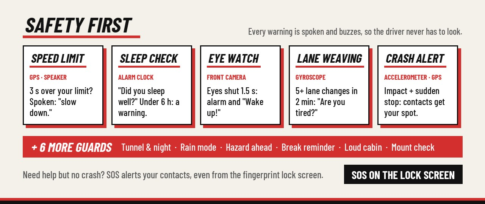
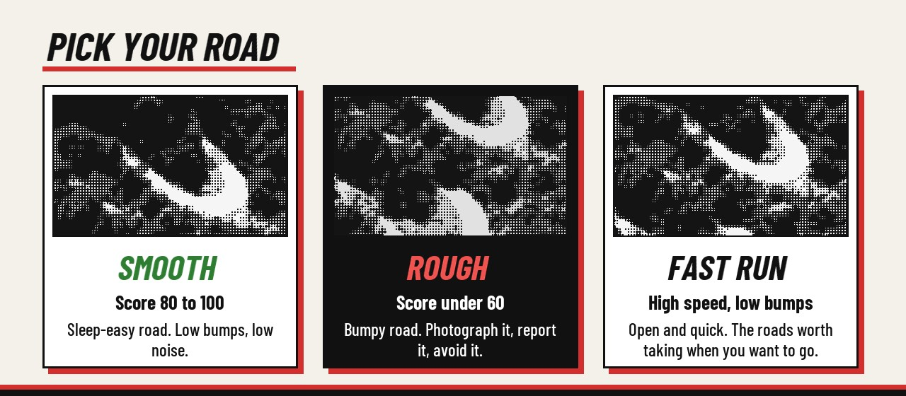
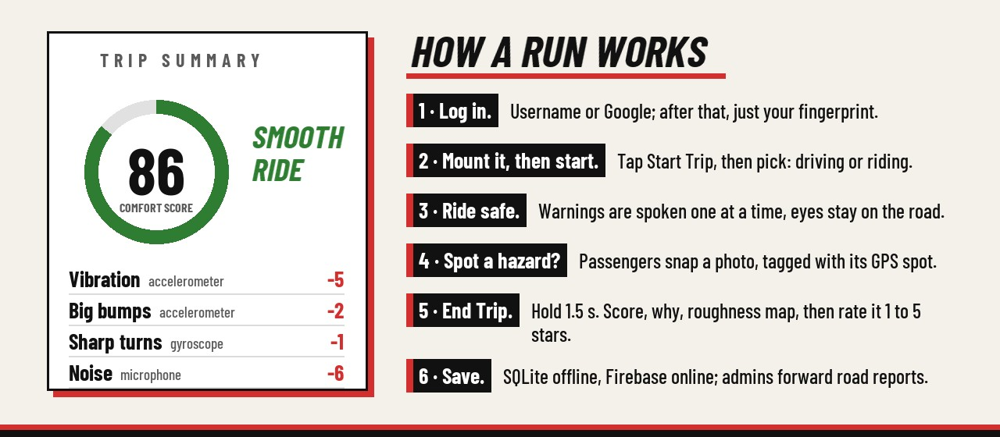
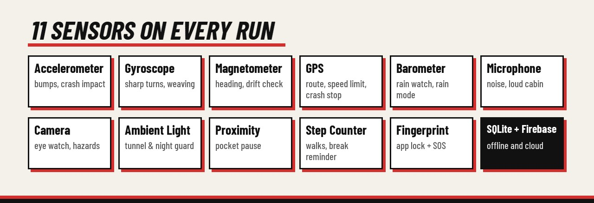
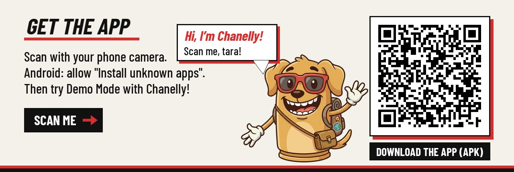

<a href="https://drive.google.com/file/d/1kbhr2t2Icuaxw7Q6h6lsMrAGWLTxH84Y/view?usp=drive_link"></a>

<p align="center">
  <b>A sensor-powered ride companion for Android.</b><br>
  Rates how comfortable your trip was, warns you about unsafe driving, and lets you report potholes and floods.<br>
  For drivers and passengers (jeepney, bus, car). Built for Metro Manila roads.
</p>

<p align="center">
  <a href="https://drive.google.com/file/d/1kbhr2t2Icuaxw7Q6h6lsMrAGWLTxH84Y/view?usp=drive_link">
    
  </a>
  
  
</p>

<p align="center">
  
  
  
  
</p>









<a href="https://drive.google.com/file/d/1kbhr2t2Icuaxw7Q6h6lsMrAGWLTxH84Y/view?usp=drive_link"></a>

---

## Read me first

1. **Never use the phone while driving.** Warnings are spoken. (RA 10913)
2. **Mount it:** stable, level, never blocking your view.
3. **Start before you go, end after you park.**
4. **Passengers can use it freely.**
5. **Warnings help, they don't replace you.** Road signs always win.
6. **Don't drive drowsy.** Answer the sleep check honestly.

## Driving or riding?

Start Trip asks *"Who are you today?"*

| | |
|---|---|
| **I'm driving** | Huge speed, the speed-limit sign and one warning at a time. Screen stays on. |
| **I'm riding** | Map and live numbers. Driver-only warnings (weaving, mount, breaks) turn off. |

Crash alert, rain, tunnel and hazards ahead stay on for both.

## Eye watch

The front camera checks if your eyes are closing. In a holder facing you, it learns your normal eyes in about 4 seconds.

| | |
|---|---|
| **Driving** | Eyes shut 1.5 s: alarm + *"Wake up!"*. Heavy eyes: *"stay focused"*, then *"please rest"*. Only at 5 km/h and up. |
| **Study / work** | Your own wake-up and lock-in messages, breaks every 25, 50 or 90 min, quiet mode for libraries. |

Gentle, Normal or Strict. Runs offline; camera frames are never saved.

## If there's a crash

1. **Alarm + 30 s countdown.** A hard impact, then a sudden stop. A giant **I'M OK** button cancels it.
2. **Contacts are texted** the time and a Google Maps link to you.
3. **Big CALL buttons.** Call a contact now. **CALL 911** opens the dialer. The app never calls on its own.

## Tuned to your phone

Every phone, car and holder shakes differently. Pick **Gentle**, **Normal** or **Sensitive**, or tap **Calibrate**: 10 s parked, engine on, and the app learns your normal shaking.

The score formula never changes, so an 80 means the same for every rider.

## Where reports go

| Report | Sent to |
|---|---|
| Road damage | DPWH, then City / Municipal Engineering |
| Flooding | MMDA + local DRRMO (Metro Manila) |
| Obstruction | MMDA or City / Municipal Engineering |
| Speed trends | LTO, PNP-HPG (totals only) |

Admins review every report. Reports never include the rider's name or email.

## Your data

Trips go only to your own account. Sleep answers and contacts never leave the phone; the mic never records and camera frames are never saved. Delete your data anytime. (RA 10173)

---

## Screenshots

### Trips & Comfort Score
<p>
  
  
  
  
</p>

### Safety
<p>
  
  
  
  
</p>

### Admin dashboard & demos
<p>
  
  
</p>

---

## Install the APK

**[Download the APK (Google Drive)](https://drive.google.com/file/d/1kbhr2t2Icuaxw7Q6h6lsMrAGWLTxH84Y/view?usp=drive_link)**

1. Open the link on your Android phone (Android 8.0 or newer) and download the APK.
2. Open the downloaded file. If Android blocks it, allow **Install unknown apps** for your browser or file manager.
3. Open **Biyahe Companion** and try **Demo Mode** with Chanelly, or create an account to record real trips.

---

<details>
<summary><b>Full feature list</b></summary>

### Trip tracking & Comfort Score
- Records your route, speed and distance with GPS and draws it on an OpenStreetMap map. No API key needed.
- Gives each trip a **Comfort Score (0–100)**, rated *Smooth*, *Fair* or *Rough*, based on vibration and bumps (accelerometer), sharp turns (gyroscope) and cabin noise (microphone; loudness only, never recorded).
- Tags **Fast Run** trips: 40 km/h or more on a smooth road.
- Counts walking steps to and from the stop.
- Shows why you got your score, a roughness map, and lets you rate the ride 1 to 5 stars.

### Safety
- **Speed limit:** ignores single bad GPS readings and doesn't nag when you hover at the limit.
- **Lane weaving:** tells normal lane changes and curves apart from repeated weaving, cross-checked with the GPS course.
- **Eye watch:** on-device face detection (ML Kit), works offline.
- **Sleep check**, **crash alert**, **SOS on the lock screen**.
- **More guards:** tunnel & night, rain mode (barometer), hazard ahead, break reminder, loud cabin, mount check.

### Hazard reporting
- Photograph a pothole, flood or obstruction and pin it to its GPS spot.
- Reports sync through Firebase Firestore.
- An **admin dashboard** reviews reports and forwards them to the right agency.

### Screen & privacy
- Ambient light dims the screen at night and in tunnels; proximity rests it in a pocket.
- Fingerprint lock on your trip history.
- Log in with a username or **Continue with Google**.

### Demo & diagnostics
- **Demo Mode** uses a separate database of sample trips and hazards with cloud sync off, so real data is never touched.
- **Sensor Check:** live test screens for all 11 sensors.
- **Drift check:** "walk a straight line" demo using the gyroscope, compass and step detection.
- Guided tour with Chanelly.

</details>

---

## Tech stack

- **Kotlin** + **Jetpack Compose** (Material 3), MVVM with ViewModels and coroutines/Flow
- **Room** (SQLite) for offline trips, hazards and accounts
- **Firebase Auth** + **Cloud Firestore** for accounts and cloud sync (free Spark plan)
- **Google Play Services Location** (fused GPS) and **osmdroid** (OpenStreetMap)
- **CameraX** + **ML Kit Face Detection** (on-device)
- **AndroidX Biometric**, **Credential Manager** (Google sign-in), **Coil**
- **JUnit** unit tests for the scoring, safety and admin logic

**Min SDK** 26 (Android 8.0) · **Target SDK** 34 · **Java** 17

---

## Building from source

### Requirements
- Android Studio (recent version) and JDK 17
- A real Android phone is strongly recommended. Emulators fake or lack most of the sensors.

### 1. Clone
```bash
git clone https://github.com/jvpangilinan/BiyaheCompanion.git
```
Open the folder in Android Studio and let Gradle sync.

### 2. Add your own Firebase config (required)
`google-services.json` is **not** included in this repo, and **the project won't build without it**.

1. Create a project in the [Firebase console](https://console.firebase.google.com/).
2. Add an Android app with package name **`com.biyahe.companion`**.
3. Download `google-services.json` into the **`app/`** folder.
4. Turn on **Authentication** (Email/Password and Google) and **Cloud Firestore**.
5. For Google sign-in, add your debug SHA-1 to the Firebase app (`./gradlew signingReport`).

### 3. Run
Connect your phone with USB debugging on and press **Run** in Android Studio.

### Tests
Unit tests run without a phone:
```bash
./gradlew test
```

---

## Permissions

| Permission | Why |
|---|---|
| Location | Route, speed, hazard pins |
| Camera | Hazard photos, eye watch |
| Microphone | Noise level only, never recorded |
| Physical activity | Step counting |
| Notifications | Trip in progress, safety alerts |
| SMS | Crash and SOS alerts to your contacts |
| Phone | Call buttons on the crash screen |

---

## Project structure

```
app/src/main/java/com/biyahe/companion/
├── admin/        Admin dashboard data & report wording
├── auth/         Accounts (local + Firebase)
├── data/         Room database, DAOs, entities, repositories, demo data
├── navigation/   Routes and bottom bar tabs
├── safety/       Speed, weaving, drowsiness, crash, drift logic
├── scoring/      Comfort Score, Fast Run, weather (barometer)
├── security/     Fingerprint lock, session
├── sensors/      Sensor hub, motion analysis, screen care, steps
├── service/      Foreground trip service + notifications
├── sync/         Firestore cloud sync
├── tracking/     GPS tracker, noise meter, trip recorder
├── trip/         Trip controller and completed trip model
└── ui/           Compose screens
```

The `README_*.md` files and `notes/` folder are development notes from building the app section by section.

---

## Team

**SENSORVERSE 2026 · Group 1** · TARP 5 · BSIT 3A · School of Engineering and Technology

- John Vincent S. Pangilinan ([@jvpangilinan](https://github.com/jvpangilinan))
- Jaden Daryl De Leon
- Samuel Encinares

ITP3110R · Mark Cherwin Alejandria
